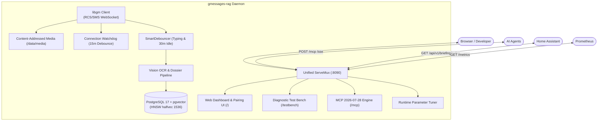

# gmessages-rag

[](LICENSE)
[](https://go.dev/)
[](https://github.com/pgvector/pgvector)
[](https://modelcontextprotocol.io/)
[](https://spelech.github.io/gmessage-rag/)

> **Real-Time Google Messages (RCS/SMS) Ingestion, Vision OCR, Living Dossier & Hybrid RAG MCP Server**

`gmessages-rag` pairs directly with Google Messages via `go.mau.fi/mautrix-gmessages/pkg/libgm` (without requiring Matrix homeservers or rooted Android phones). It ingests texts, reactions, and RCS media, groups them into contiguous 2-hour conversation sessions, runs multimodal Vision OCR on shared images, continuously reconciles a self-updating "Living Dossier" state engine per tracked contact, and exposes an agent-native Model Context Protocol (MCP) server alongside Home Assistant REST/webhook APIs and a built-in diagnostic test bench.

📖 **Official Documentation Portal**: [https://spelech.github.io/gmessage-rag/](https://spelech.github.io/gmessage-rag/)

---

## Key Capabilities

1. **Matrix-Free Real-Time RCS/SMS Sync:**
   - Pairs via cookie import (`gmessages-rag pair --cookies` or the web dashboard `/pair`), followed by the single-device Google Account (Gaia) emoji challenge (`AUTH-04`).
   - Ingests incoming/outgoing messages, emoji reactions, and reply chains into PostgreSQL 17.
   - Paginates historical message backfills via standardized 3-stage batch ETL (`PIPE-06`).
2. **Content-Addressed Media & Vision OCR Pipeline:**
   - Decrypts RCS attachments to two-tier SHA-256 storage at `/data/media/<xx>/<yy>/<hash>.<ext>`.
   - Runs vision OCR and visual scene descriptions via OpenAI-compatible vision models (`PIPE-01`).
   - Optional full-resolution media retrieval (`PULL_FULL_SIZE_MEDIA=true`, `SEC-02`).
3. **2-Hour Session Windowing & Hybrid RAG:**
   - Groups contiguous messages ($\le 2\text{ hours}$ silence) into `conversation_sessions` with calendar headers.
   - Fuses PostgreSQL full-text search (`ts_rank_cd`) and vector cosine similarity (`<=>`) over `halfvec(1536)` embeddings using Reciprocal Rank Fusion ($k=60$).
4. **Self-Updating "Living Dossier" State Engine:**
   - Action-aware debouncer (`SmartDebouncer`, `PIPE-05`) pauses on participant typing indicators (`UpdateEvents_TypingEvent`) and flushes on 30 minutes of silence.
   - LLM reconciles state, resolves relative dates (*"next Tuesday"* $\rightarrow$ explicit date), maintains chronological overrides, and exports Markdown dossiers to `/data/dossiers/<contact>.md` (`PIPE-03`).
   - Complete audit trail preserved in `contact_dossier_history` (`DB-05`).
5. **Agent-Native MCP Server with Prompt Injection Guardrails:**
   - Implements MCP specification `2026-07-28` across Streamable HTTP (`POST /mcp`), Server-Sent Events (`GET /sse`), and `stdio` (`MCP-00`).
   - Provides 6 core tools: `list_conversations`, `get_contact_dossier`, `search_conversation_history`, `get_messages_around_time`, `search_shared_media`, and `manage_tracked_contact`.
   - Encloses all raw external conversational text and OCR in `<untrusted_conversation_data>` XML guardrails (`GUARD-01`).
6. **Embedded Web Management UI & Diagnostic Test Bench:**
   - Web Management Dashboard on `/` and `/dashboard` with tracked contact toggles and cookie-import pairing console (`UI-01`).
   - Context-Cortex style Developer Diagnostic Test Bench on `/testbench` for ad-hoc MCP testing, Hybrid RRF scoring inspection, and XML boundary auditing (`UI-02`).
   - Hot-reloadable runtime parameter tuner on `/api/v1/tuner` (`UI-03`).
7. **Observability, Watchdog & Push Alerting:**
   - Native Prometheus `/metrics` and `/healthz` probes (`OBS-01`).
   - Watchdog monitoring connection drops with 15-minute debouncing and universal Apprise/ntfy push alerts (`NOTIF-01`, `NOTIF-02`, `TRANS-04`).

---

## Architecture Overview



---

## Quick Start

### 1. Clone Repository & Configure Environment
```bash
git clone https://github.com/spelech/gmessage-rag.git
cd gmessage-rag
cp .env.example .env
# Edit .env with your OpenAI/OpenRouter API keys and configuration
```

### 2. Launch Services with Docker Compose
```bash
docker compose up -d --build
```

Check container status and logs:
```bash
docker compose ps
docker compose logs -f gmessages-rag
```

### 3. Pair with Google Messages

Device pairing uses cookie import. Import Google session cookies from a signed-in browser.

1. Sign in to [https://messages.google.com/web](https://messages.google.com/web) in your browser.
2. Open DevTools (`F12`) and switch to the **Network** tab.
3. Select a request to `messages.google.com` (for example `config`).
4. Right-click the request and choose **Copy** → **Copy as cURL**.

#### Option A: CLI (Recommended)
```bash
docker compose exec -it gmessages-rag gmessages-rag pair --cookies -
```
Paste the cURL command, then press Ctrl-D. The daemon validates the cookies, saves the session, and starts the Gaia emoji challenge. Open Google Messages on your phone, go to **Device Pairing**, and tap the matching emoji.

You can also read cookies from a file:
```bash
docker compose exec -it gmessages-rag gmessages-rag pair --cookies /data/auth/google-cookies.txt
```

#### Option B: Web Dashboard
Open [http://localhost:8090/pair](http://localhost:8090/pair) in your web browser. Paste the cURL command into the text area and select **Pair with cookies**. The page shows the Gaia emoji challenge when Google accepts the cookies.

---

## Web Management UI & Developer Workbench

Once running, navigate to port `8090` on your host:

- **Web Management Dashboard**: [http://localhost:8090/](http://localhost:8090/) — View connection state, database metrics, tracked contacts, and pairing controls.
- **Diagnostic Test Bench**: [http://localhost:8090/testbench](http://localhost:8090/testbench) — Run ad-hoc MCP tool invocations, examine Hybrid RRF score breakdowns, and inspect XML guardrail boundaries.
- **Prometheus Metrics**: [http://localhost:8090/metrics](http://localhost:8090/metrics) — Scrape daemon ingestion counters and session gauges.
- **Health Probes**: [http://localhost:8090/healthz](http://localhost:8090/healthz) — Probe database connectivity and WebSocket status.

---

## Environment Variable Matrix

| Variable | Default Value | Description |
| :--- | :--- | :--- |
| **`POSTGRES_USER`** | `rcsrag` | Database username |
| **`POSTGRES_PASSWORD`** | `changeme` | Database password |
| **`POSTGRES_DB`** | `gmessages` | Database name |
| **`DATABASE_URL`** | `postgres://rcsrag:changeme@db:5432/gmessages?sslmode=disable` | PostgreSQL connection string |
| **`TZ`** | `America/Chicago` | Container timezone for transcript rendering |
| **`HTTP_PORT`** | `8090` | Internal container port for unified ServeMux |
| **`HOST_PORT`** | `8090` | Host port mapped by docker-compose |
| **`DATA_DIR`** | `./data` | Host directory mounted for persistent state |
| **`PUID`** | `1000` | User ID for file storage permissions |
| **`PGID`** | `1000` | Group ID for file storage permissions |
| **`LLM_BASE_URL`** | `https://openrouter.ai/api/v1` | OpenAI-compatible LLM endpoint base URL |
| **`LLM_API_KEY`** | `""` | API key for LLM completion requests |
| **`DOSSIER_MODEL`** | `anthropic/claude-3.7-sonnet` | Model used for Living Dossier state reconciliation |
| **`SUMMARY_MODEL`** | `google/gemini-2.5-flash` | Model used for 2-hour session transcript summaries |
| **`VISION_MODEL`** | `google/gemini-2.5-flash` | Multimodal model used for Vision OCR and scene analysis |
| **`EMBEDDING_BASE_URL`** | `https://api.openai.com/v1` | OpenAI-compatible embedding API base URL |
| **`EMBEDDING_API_KEY`** | `""` | API key for embedding generation |
| **`EMBEDDING_MODEL`** | `text-embedding-3-small` | Model used for transcript embeddings |
| **`EMBEDDING_DIMENSIONS`**| `1536` | Vector dimensionality (must match `halfvec(1536)`) |
| **`TRACKED_CONTACTS`** | `""` | Comma-separated conversation IDs to actively track & backfill |
| **`SESSION_GAP_HOURS`** | `2` | Silence duration in hours terminating a session chunk |
| **`DOSSIER_DEBOUNCE_MINUTES`** | `30` | Idle messaging silence required before dossier reconciliation |
| **`MAX_BACKFILL_MESSAGES`** | `5000` | Maximum messages to fetch during initial cursor pagination |
| **`ENABLE_MCP_SEND_MESSAGE`**| `false` | Gatekeeper guardrail allowing outbound `send_message` MCP tool |
| **`MCP_ACCESS_TOKEN`** | `""` | Optional bearer token required on every `tools/call` (`Mcp-Access-Token` or `Authorization: Bearer`) |
| **`WEBHOOK_URL`** | `""` | Outbound HTTP POST target triggered on dossier updates |
| **`APPRISE_URL`** | `""` | Apprise notification gateway URL for push alerts |
| **`NTFY_URL`** | `""` | ntfy topic URL for direct mobile push notifications |
| **`EXTERNAL_WEB_URL`** | `http://localhost:8090` | Publicly reachable daemon URL embedded in alert action buttons |
| **`NOTIFY_ON_PHONE_DISCONNECT`**| `false` | Enable push alerts when phone disconnects from Google Messages |
| **`PHONE_DISCONNECT_GRACE_MINUTES`**| `15` | Watchdog grace period preventing transient cell drop alerts |
| **`ENABLE_READ_RECEIPT_HEURISTIC`**| `true` | Infer preceding outgoing message delivery from incoming replies |
| **`PULL_FULL_SIZE_MEDIA`**| `false` | Opt-in to download original high-resolution media before OCR |
| **`SYNC_GOOGLE_CONTACTS`**| `true` | Periodically synchronize names and avatars via `ListContacts` |
| **`SYNC_MODE`**| `continuous` | `continuous` (always connected) or `periodic` (connect per window, saves phone battery) |
| **`SYNC_INTERVAL_MINUTES`**| `30` | Minutes between periodic sync windows |
| **`SYNC_WINDOW_MINUTES`**| `5` | Minutes the connection stays open each periodic window |
| **`GM_PING_INTERVAL_MINUTES`**| `5` | Ditto ping interval; lower wakeups than the 1-minute default |
| **`GM_ALERT_TIMEOUT_COUNT`**| `2` | Missed pings before phone-not-responding fires |

---

## MCP Client Configuration

To connect `gmessages-rag` to an MCP client (such as Claude Desktop, OpenCode, or Antigravity):

### Streamable HTTP Transport (Recommended)
```json
{
  "mcpServers": {
    "gmessages": {
      "url": "http://localhost:8090/mcp"
    }
  }
}
```

### Stdio Transport (Local CLI)
```json
{
  "mcpServers": {
    "gmessages": {
      "command": "docker",
      "args": ["exec", "-i", "gmessages-rag", "gmessages-rag", "serve", "--stdio"]
    }
  }
}
```

---

## Living Documentation

- 📚 **VitePress Docs Portal**: [https://spelech.github.io/gmessage-rag/](https://spelech.github.io/gmessage-rag/)
- 📐 [**`docs/ARCHITECTURE.md`**](docs/ARCHITECTURE.md): Full daemon topology, ServeMux routing, concurrency model, and sequence diagrams.
- 📋 [**`docs/REQUIREMENTS.md`**](docs/REQUIREMENTS.md): SRS with category taxonomy (`AUTH`, `DB`, `PIPE`, `OBS`, `UI`, `SEC`, `HARN`, `DOCKER`, `DAEMON`) and traceability matrix.
- 📜 [**`docs/CHANGELOG.md`**](docs/CHANGELOG.md): SemVer release history under `[1.0.0]`.
- 🗺️ [**`docs/PLAN.md`**](docs/PLAN.md): Implementation and integration roadmap across Phases 1 through 4.
- 🛡️ [**`AGENTS.md`**](AGENTS.md) / [**`GEMINI.md`**](GEMINI.md): Master engineering guidelines and anti-test-theatre standards.

---

## License

`gmessages-rag` is licensed under the [GNU Affero General Public License v3.0 (AGPL-3.0)](LICENSE).
