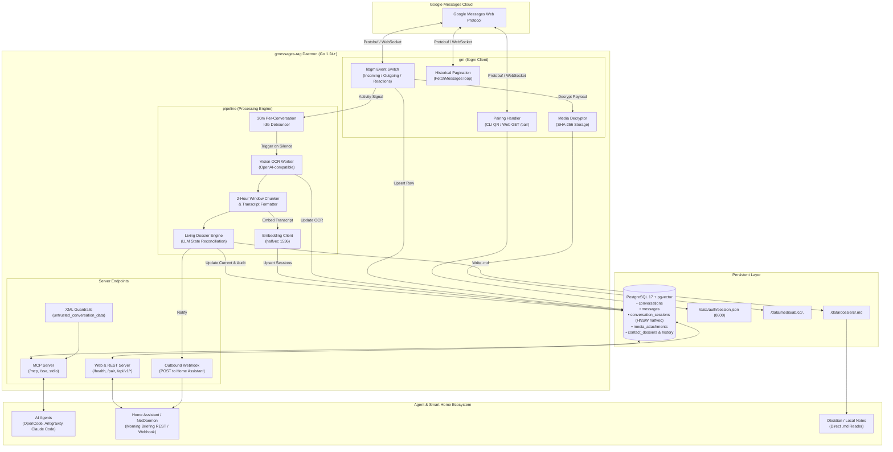
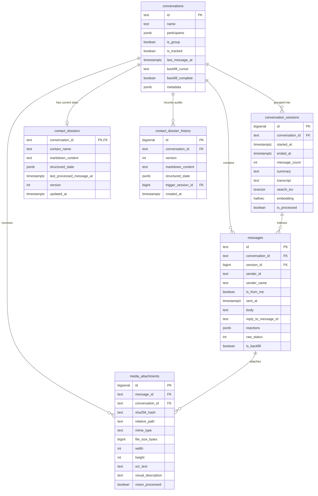
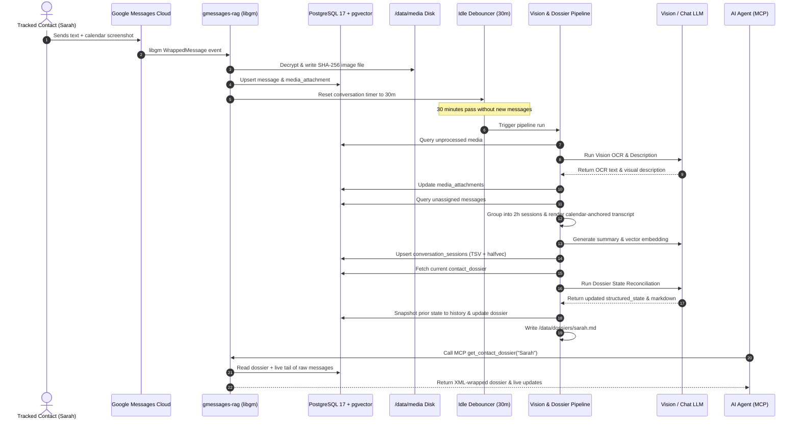

# System Architecture: gmessages-rag

`gmessages-rag` is a self-contained Go daemon that pairs directly with Google Messages (RCS/SMS), stores messages in PostgreSQL 17 + `pgvector`, runs Vision OCR and 2-hour session chunking, maintains self-updating Living Dossiers per tracked contact, and exposes an agent-native Model Context Protocol (MCP) server alongside Home Assistant REST/webhook APIs.

---

## Architectural Topology



---

## Data Model and Schema Architecture



---

## Real-Time Ingestion and Pipeline Lifecycle



---

## Directory and Subsystem Layout

```text
gmessages-rag/
├── cmd/
│   └── gmessages-rag/
│       └── main.go                 # CLI entrypoint (pair, serve, backfill, status)
├── internal/
│   ├── config/
│   │   └── config.go               # Env var & configuration loader
│   ├── db/
│   │   ├── migrations/
│   │   │   └── 001_init.sql        # Embedded pgvector & schema migrations
│   │   ├── db.go                   # pgxpool connection & migration runner
│   │   ├── messages.go             # Upsert messages, conversations, reactions
│   │   ├── sessions.go             # 2-hour session grouping & Hybrid RRF queries
│   │   └── dossiers.go             # Living dossier CRUD & snapshot versioning
│   ├── gm/
│   │   ├── client.go               # libgm wrapper, event switch, reconnect loop
│   │   ├── pairing.go              # QR terminal + Web UI QR & Gaia pairing handlers
│   │   ├── media.go                # Media download, decryption & SHA-256 storage
│   │   └── backfill.go             # Historical pagination via client.FetchMessages
│   ├── pipeline/
│   │   ├── debouncer.go            # Per-conversation idle timer (e.g., 30m)
│   │   ├── sessionizer.go          # Groups unindexed messages into 2h sessions
│   │   ├── vision.go               # Multimodal OCR + image description worker
│   │   ├── embedder.go             # OpenAI-compatible batch embedding client
│   │   ├── dossier.go              # LLM state-reconciliation engine + Markdown writer
│   │   └── prompts.go              # System prompts for Vision, Session Summary & Dossier
│   ├── mcpserver/
│   │   ├── server.go               # Streamable HTTP / SSE MCP server setup
│   │   ├── tools.go                # 6 core MCP tool handlers
│   │   └── guardrails.go           # XML boundary wrapping for untrusted text
│   └── web/
│       ├── server.go               # Lightweight HTTP server (/health, /pair, /api/*)
│       └── webhook.go              # Outbound webhook notifier (Home Assistant / MQTT)
├── data/                           # Local bind-mount directory (git-ignored)
│   ├── auth/                       # Holds session.json (0600 permissions)
│   ├── media/                      # Content-addressed decrypted attachments
│   └── dossiers/                   # Auto-exported Markdown files (<slug>.md)
├── docs/                           # Living Documentation
│   ├── ARCHITECTURE.md             # System topology and sequence diagrams
│   ├── REQUIREMENTS.md             # SRS with traceability matrix
│   └── CHANGELOG.md                # SemVer change history
├── scripts/                        # Git Flow and operational scripts
│   └── commit.sh                   # Conventional Commit and branch validator
├── .github/                        # CI/CD and automation
│   ├── dependabot.yml              # Dependency update configuration
│   └── workflows/
│       └── ci.yml                  # 4-stage CI pipeline
├── Dockerfile                      # Multi-stage Alpine container
├── docker-compose.yml              # Local orchestration with pgvector
├── Makefile                        # Local build and test targets
└── README.md                       # Project overview and quick start
```
