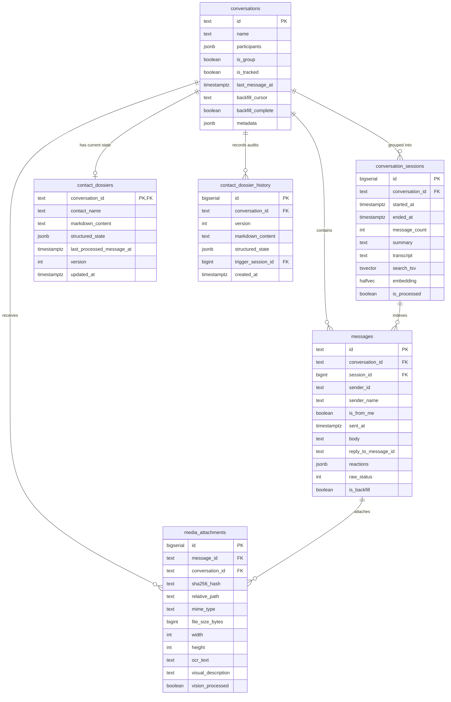

# Data Model & Schema Architecture

The persistent layer uses PostgreSQL 17 with the `pgvector` extension, leveraging `halfvec(1536)` embeddings and full-text search dictionaries.

## Entity Relationship Diagram

## Schema Highlights

- **HNSW halfvec Indexing**: Embeddings are stored as `halfvec(1536)` with an HNSW cosine index (`vector_cosine_ops`), cutting index memory consumption by 50% while maintaining high recall.
- **Full-Text GIN Indexing**: `conversation_sessions.search_tsv` maintains an indexed lexeme representation generated via `to_tsvector('english', transcript)`.
- **Dossier Audit History**: Every update to `contact_dossiers` creates an immutable row in `contact_dossier_history` with the triggering session ID and timestamp.
