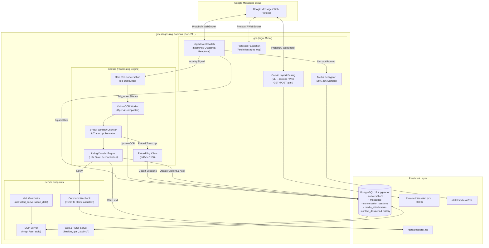

# System Architecture

`gmessages-rag` is built as an observable, high-performance Go daemon that synchronizes Google Messages in real time, organizes conversations into calendar-anchored chunks, and exposes them to AI agents via Model Context Protocol (MCP).

## Architectural Topology

## Subsystem Responsibilities

1. **Ingestion Engine (`internal/gm`)**: Communicates with Google Messages Web WebSocket endpoints, handles pairing handshakes, and receives raw protobuf frames.
2. **Processing Pipeline (`internal/pipeline`)**: Debounces conversational bursts, manages 2-hour windowing, extracts OCR from images, and triggers LLM state updates.
3. **Database Layer (`internal/db`)**: Manages transactions, idempotency, HNSW indexing on vector embeddings, and full-text search dictionaries.
4. **Agent & Web Interfaces (`internal/mcpserver`, `internal/web`)**: Serves JSON-RPC 2.0 MCP requests, exposes diagnostic test benches, and dispatches home automation alerts.
