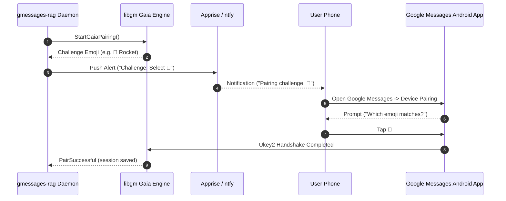

# Pairing Workflows (`AUTH-01` - `AUTH-05`)

`gmessages-rag` supports multiple authentication mechanisms to connect with Google Messages without requiring physical cables or Matrix homeservers.

Single-device Google Account (Gaia) emoji challenge pairing is the default path (`AUTH-05`). Legacy camera QR pairing remains available as a fallback (`AUTH-02`).

## Workflow A: Google Account Gaia Emoji Pairing (Default, `AUTH-04`, `AUTH-05`)

Single-device emoji challenge pairing is the default pairing workflow across CLI and web:



### CLI Execution
Run terminal pairing directly:
```bash
docker exec -it gmessages-rag gmessages-rag pair
```
The CLI immediately initiates the Gaia challenge and prints the emoji to select on your phone.

### Web Execution
Navigate to the web pairing endpoint:
```
http://localhost:8090/pair
```
The browser view displays the matching emoji challenge and automatically refreshes upon confirmation.

1. Open Google Messages on your phone > **Device pairing**.
2. Tap the matching emoji on your screen.
3. Credentials automatically persist to `/data/auth/session.json` with POSIX `0600` permissions.

---

## Workflow B: Legacy QR Code Terminal & Web Fallback (`AUTH-02`)

If Gaia emoji pairing is unavailable or you prefer camera scanning:

### Terminal QR Scan
Pass the explicit `--qr` flag:
```bash
docker exec -it gmessages-rag gmessages-rag pair --qr
```

A QR code renders directly in your terminal:
1. Open **Google Messages** on your Android phone.
2. Tap your profile icon or three dots > **Device pairing**.
3. Tap **QR code scanner** and scan the terminal QR code.

### Web Management QR Code
Pass `?mode=qr` in your browser:
```
http://localhost:8090/pair?mode=qr
```
- Displays live auto-refreshing QR code images (`/pair?mode=qr&format=png`).
- Includes a link to return to the recommended Gaia emoji challenge flow.
