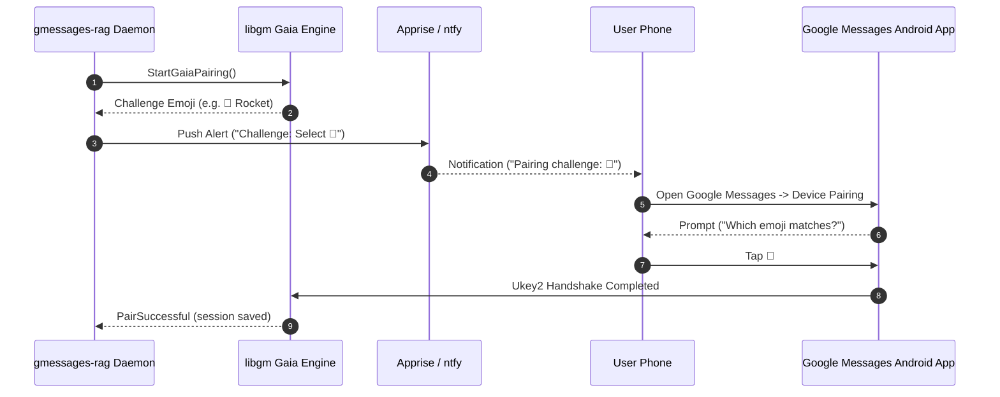

# Pairing Workflows (`AUTH-01` - `AUTH-04`)

`gmessages-rag` supports multiple authentication mechanisms to connect with Google Messages without requiring physical cables or Matrix homeservers.

## Workflow A: Terminal QR Code (`AUTH-02`)

For command-line pairing:

```bash
docker exec -it gmessages-rag gmessages-rag pair
```

A QR code renders directly in your terminal:
1. Open **Google Messages** on your Android phone.
2. Tap your profile icon or three dots > **Device pairing**.
3. Tap **QR code scanner** and scan the terminal QR code.
4. Credentials are automatically saved to `/data/auth/session.json` with POSIX `0600` permissions.

## Workflow B: Web Management QR Code (`AUTH-02`)

Open the Web Dashboard pairing page in your browser:

```
http://localhost:8090/pair
```

- Features live auto-refreshing SVG/PNG QR codes.
- Automatically transitions upon scan confirmation.

## Workflow C: Single-Device Gaia Emoji Pairing (`AUTH-04`)

When pairing on a mobile phone without a second computer screen, camera QR scanning is impossible. `gmessages-rag` supports native Google Account (Gaia) pairing:



1. Navigate to `/pair` or trigger Gaia pairing.
2. The daemon requests a pairing challenge from Google.
3. The expected emoji (e.g. `🚀` or `🐶`) is displayed on the web interface or pushed via Apprise/ntfy.
4. Open Google Messages on the same phone and tap the matching emoji. **No camera scan required.**
