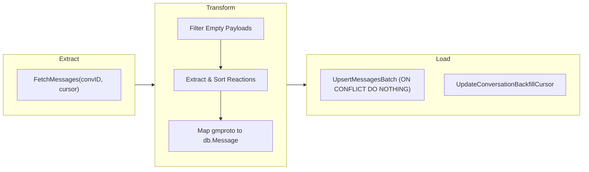
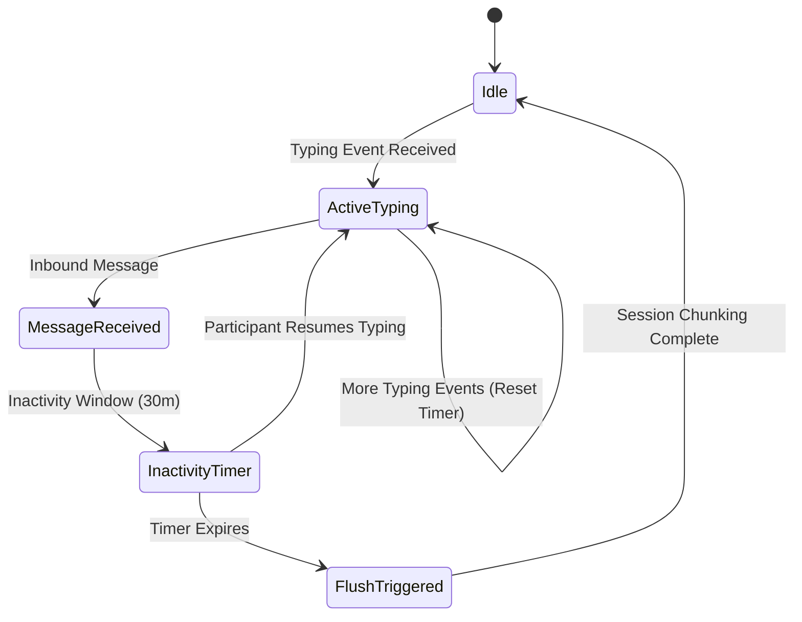

# Ingestion, Sessionization & Decryption Pipelines

This document details the multi-stage ingestion, streaming media decryption, and session chunking pipelines that process incoming RCS and SMS traffic.

---

## 1. 3-Stage Batch ETL Pipeline (`PIPE-06`)

Historical message synchronization executes via a standardized 3-stage ETL pipeline (`internal/pipeline/etl.go`):



### 1. Extract Stage
- Fetches batches of historical messages using Google Messages protobuf RPCs (`FetchMessages`).
- Supports cursor progression and rate-limiting politeness delays (`opts.Delay`).

### 2. Transform Stage
- Sanitizes incoming payloads:
  - Deduplicates reactions into timestamped JSON arrays (`[{"emoji": "👍", "sender": "+1555..."}]`).
  - Normalizes Unix timestamps (microsecond to standard UTC time).
  - Flags protocol type: RCS vs SMS.

### 3. Load Stage
- Performs transactional bulk insertion (`UpsertMessagesBatch`) with PostgreSQL `ON CONFLICT (id) DO NOTHING` idempotency.
- Atomically advances the backfill cursor in the `conversations` table.

---

## 2. Action-Aware Smart Debouncer (`PIPE-05`)

Traditional fixed-interval timers either fragment fast conversation bursts or delay session processing unnecessarily. The `SmartDebouncer` solves this dynamically:



### Event Ingestion Hooks
- **`EventInboundMessage`**: Resets conversation flush timer.
- **`EventParticipantTyping`**: Google Messages emits `UpdateEvents_TypingEvent` over long polling when the remote participant is typing. The debouncer treats typing as an active conversation signal and extends the window.
- **`EventTypingStopped`**: Resets back to default inactivity grace window.

---

## 3. Streaming Media Decryption & Storage (`SEC-01`, `SEC-02`)

Media attachments (photos, videos, audio notes, documents) sent over RCS are end-to-end encrypted with AES-GCM.

### Decryption Architecture
1. **Key Extraction**: Media keys and initialization vectors are parsed from `gmproto.MediaContent`.
2. **Streaming Decryption**: The media stream is decrypted on-the-fly into a temporary spool file to bound RAM usage, even for large video files.
3. **Content-Addressed Layout**: Files are hashed using SHA-256 and stored in a two-tier directory layout:
   ```
   /data/media/
   ├── 4a/
   │   └── b2/
   │       └── 4ab2c79f8e1234567890abcdef.jpg
   ```
4. **POSIX Permission Enforcement**: Files are atomically renamed and chmodded to `0600` (readable only by the service process).
5. **Full-Resolution Retrieval (`SEC-02`)**: When `PULL_FULL_SIZE_MEDIA=true`, the client queries `GetFullSizeImage` before falling back to standard attachments.
