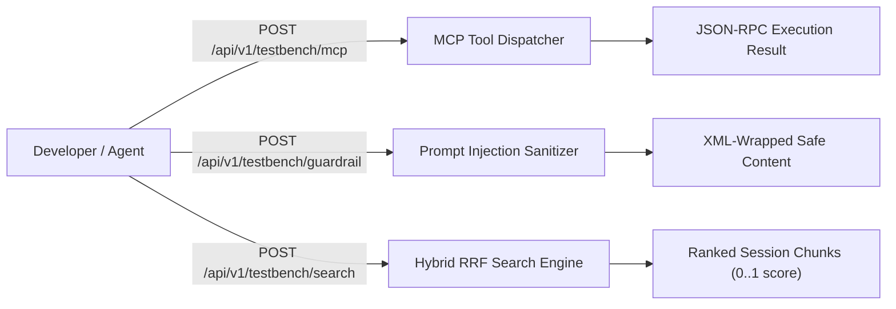

# Web Management Dashboard & UI Diagnostics

The `gmessages-rag` daemon embeds a dark-mode web management console, mobile pairing interface, diagnostic workbench, and runtime parameter tuner directly in the binary via Go's `embed.FS`.

---

## 1. Web Management Dashboard (`UI-01`)

The Management Dashboard is served at `GET /` and `GET /dashboard`. It provides operators with live connection telemetry, phone pairing state, and contact tracking controls without requiring command-line access.

### Route & Endpoints
| Route | Method | Description |
| :--- | :--- | :--- |
| `/` | `GET` | Embedded Single Page Application (SPA) dashboard |
| `/dashboard` | `GET` | Dashboard alias |
| `/api/v1/status` | `GET` | Real-time connection, database, and message count telemetry |
| `/api/v1/contacts` | `GET` | Returns list of tracked contacts and synchronizable threads |
| `/api/v1/contacts/track` | `POST` | Dynamically updates the `is_tracked` state for a contact |

### Key Features
- **Live Connection Health**: Visual indicators for Google Messages long-polling connection, database pool latency, and total ingested SMS/RCS message counts.
- **Tracked Contacts Roster**: Direct toggles for contacts to track for selective backfill and living dossier generation (`TRACKED_CONTACTS`).
- **Trigger Historical Backfill**: Push button to initiate batch historical backfill on demand.

---

## 2. Terminal & Web QR Visualizer (`AUTH-01`, `AUTH-04`)

When pairing a new Android phone running Google Messages, `gmessages-rag` offers two pairing modalities:

### Web Pairing Visualizer (`/pair`)
- Serves an embedded SVG/PNG QR code rendered via `github.com/skip2/go-qrcode`.
- Auto-refreshes every 30 seconds until the phone camera scans the code.
- Automatically transitions the UI to "Paired & Connected" upon approval via `PairingHandler.Start`.

### Single-Device Gaia Emoji Pairing (`AUTH-04`)
- Available at `/pair/gaia` or via CLI: `gmessages-rag pair --gaia`.
- Does **not** require scanning with a camera. Google sends a 3-emoji challenge to the phone; the terminal/web UI displays the matching target emoji.
- Selecting the matching emoji on your phone approves the paired session.

---

## 3. Diagnostic Test Bench (`UI-02`)

The Diagnostic Test Bench (context-cortex style) provides an interactive API sandbox at `GET /testbench` and `POST /api/v1/testbench/*` for developers and AI agents to verify retrieval pipelines, guardrails, and MCP tool execution in real-time.



### Endpoints
1. **MCP Tool Invocation Sandbox (`/api/v1/testbench/mcp`)**:
   - Executes MCP tools in-process without needing an active stdio/SSE client.
   - Example payload:
     ```json
     {
       "tool": "search_messages",
       "arguments": {
         "conversation_id": "conv-123",
         "query": "flight reservation",
         "limit": 5
       }
     }
     ```
2. **Guardrail Inspector (`/api/v1/testbench/guardrail`)**:
   - Verifies the `WrapUntrustedData` XML barrier and tests evasion payloads against prompt injection vulnerabilities (`GUARD-01`).
3. **Hybrid RRF Search Benchmark (`/api/v1/testbench/search`)**:
   - Compares raw Full-Text Search (tsvector BM25) vs Vector Cosine Distance vs Hybrid Reciprocal Rank Fusion (RRF with $k=60$).

---

## 4. Parameter & Pipeline Hot-Reload Tuner (`UI-03`)

The parameter tuner allows dynamic tuning of runtime thresholds without restarting the daemon process.

- **Endpoint**: `GET /api/v1/tuner` and `POST /api/v1/tuner`
- **Tuner Schema**:
  ```json
  {
    "debouncer_idle_minutes": 30,
    "rrf_k_factor": 60,
    "ocr_endpoint": "https://openrouter.ai/api/v1",
    "backfill_batch_size": 100
  }
  ```
- **Live Updating**:
  - `debouncer_idle_minutes`: Controls inactivity window before session chunking triggers.
  - `rrf_k_factor`: Balances dense vector semantic relevance against keyword matches in the RRF equation:
    $$RRF(d) = \sum_{m \in M} \frac{1}{k + r_m(d)}$$
  - `ocr_endpoint`: Updates the Vision OCR LLM endpoint URL on the fly.
  - `backfill_batch_size`: Sets historical page size for Google Messages sync.
