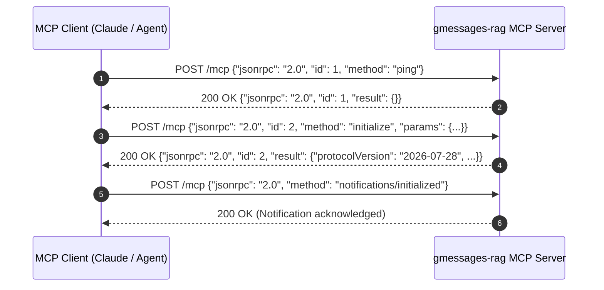

# Model Context Protocol Specification (`MCP-00`)

`gmessages-rag` strictly implements the **`2026-07-28` Model Context Protocol (MCP)** specification.

## Protocol Characteristics

- **Protocol Version Header**: All HTTP responses return:
  ```http
  Mcp-Protocol-Version: 2026-07-28
  Content-Type: application/json
  ```
- **Error Format**: Compliant JSON-RPC 2.0 error payloads with integer error codes and diagnostic strings.

## Supported Transports

1. **Streamable HTTP (`POST /mcp`)**: Stateless HTTP transport returning immediate JSON-RPC responses.
2. **Server-Sent Events (`GET /sse`)**: Persistent streaming transport for server-initiated notifications.
3. **Standard Input/Output (`stdio`)**: Interactive line-delimited JSON-RPC execution for local LLM tools (`gmessages-rag serve --stdio`).

## Core Handshake & Ping Sequence


