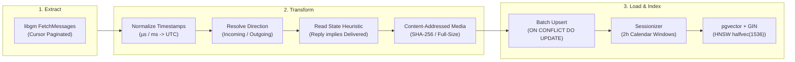

# ETL & Ingestion Pipeline (`PIPE-06`, `DB-06`)

`gmessages-rag` processes both continuous real-time events and high-volume historical backfill using a standardized three-stage ETL pipeline.

## 3-Stage ETL Architecture

## Inferred Read & Delivery Heuristic (`DB-06`)

Carrier SMS and cross-platform messages often drop explicit read receipts (`OUTGOING_DISPLAYED`). When `ENABLE_READ_RECEIPT_HEURISTIC=true`:

- An incoming reply from contact $C$ at timestamp $T_{\text{reply}}$ proves that prior messages were delivered.
- All preceding outgoing messages to $C$ where $T_{\text{sent}} \le T_{\text{reply}}$ lacking status are automatically inferred as delivered ($108$).

## Action-Aware Debouncing (`PIPE-05`)

The 30-minute per-conversation idle timer resets whenever:
- A new incoming or outbound message is detected.
- A typing indicator (`TypingTypes_STARTED_TYPING`) is received.
- Typing actions keep the debouncer held open, preventing fragmented sessions while participants are composing responses.
