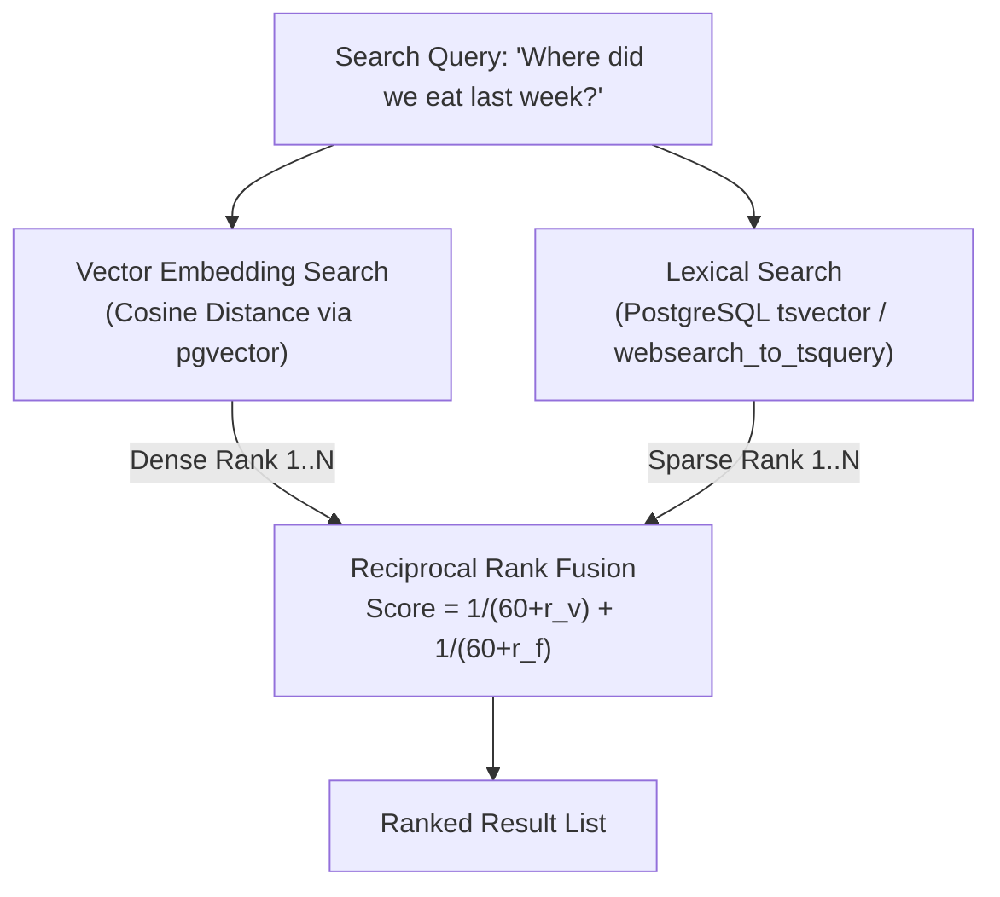

# Living Dossier & Hybrid RAG Retrieval

This specification details the 2-hour session chunking algorithm, living dossier summarization, and Hybrid Reciprocal Rank Fusion (RRF) search mechanics.

---

## 1. 2-Hour Inactivity Session Chunking (`DB-03`)

Conversation streams are partitioned into coherent sessions using a 2-hour inactivity threshold:

$$\Delta t = t_{i} - t_{i-1} > 2\text{ hours}$$

```mermaid
timeline
    title 2-Hour Inactivity Boundary
    09:00 : "Hey, are we still on for lunch?"
    09:02 : "Yes, meeting at 12:30."
    09:05 : "Great, see you then!"
    14:30 : "Did you see the latest project update?" : New Session Triggered (> 2 hrs)
```

### Session Enrichment
Each completed session chunk triggers an LLM background summarization:
- **Title Generation**: Short 3-6 word semantic topic (e.g. `Lunch Meeting & Reservation`).
- **Summary**: Concise bullet points capturing action items, decisions, and context.
- **Dense Embedding**: Generates a 1536-dimensional vector using `text-embedding-3-small` (or configured embedding model) stored as `halfvec(1536)` in PostgreSQL.

---

## 2. Living Dossiers (`DB-04`, `DB-05`)

A **Living Dossier** is an evolving Markdown document maintained for each tracked contact. It synthesizes cross-session knowledge over time:

### Dossier Structure
```markdown
# Dossier: Jane Doe (+15551234567)
*Last Updated: 2026-11-02 08:30 UTC*

## Profile & Key Context
- Close colleague from engineering infrastructure team.
- Prefers communication via RCS / Signal.

## Ongoing Projects & Commitments
- Migration to pgvector 17 (Target: Q4).
- Weekly architecture reviews every Thursday at 10 AM.

## Communication Patterns
- Highly active weekday mornings.
- Frequently exchanges code snippets and architectural diagrams.
```

### Self-Updating Workflow
When new sessions are chunked, the system retrieves the previous dossier, feeds it alongside the new session summaries to the LLM (`DOSSIER_MODEL`), and generates an updated document atomically persisted to PostgreSQL and spooled to `/data/dossiers/<contact_id>.md`.

---

## 3. Hybrid Reciprocal Rank Fusion (RRF)

To maximize retrieval recall and precision across complex personal messaging histories, `gmessages-rag` combines **dense vector similarity** with **lexical Full-Text Search (BM25)** using Reciprocal Rank Fusion:

$$RRF(d) = \sum_{m \in \{\text{vector}, \text{fts}\}} \frac{1}{k + r_m(d)}$$

Where:
- $k$ is the smoothing constant (default $k=60$, configurable via `/api/v1/tuner`).
- $r_m(d)$ is the 1-based rank of document $d$ within ranking method $m$.



### Advantages of Hybrid RRF
- **Keyword Exact Match**: Captures exact phone numbers, flight confirmation codes, addresses, and timestamps where semantic embeddings often fail.
- **Conceptual Match**: Captures broad intent (e.g., *"recommendations for dinner"*) even when words like *"restaurant"* or *"food"* were not explicitly mentioned.
