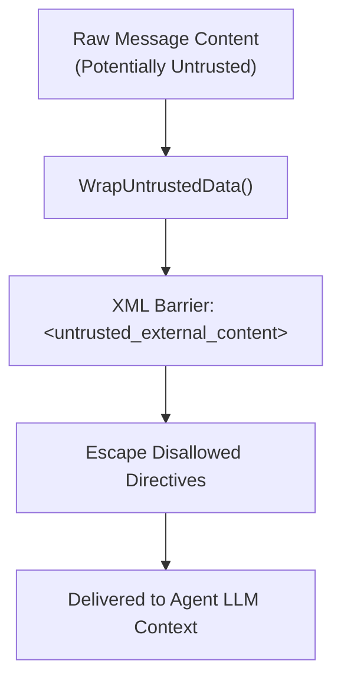

# Agent-Native Model Context Protocol (MCP) Specification

`gmessages-rag` exposes an agent-native Model Context Protocol (MCP) server adhering strictly to the **MCP 2026-07-28** standard.

---

## 1. Transports Supported

| Transport | Endpoint / Path | Use Case |
| :--- | :--- | :--- |
| **Streamable HTTP** | `POST /mcp` | Fast bidirectional RPC sessions with HTTP streaming responses |
| **Server-Sent Events (SSE)** | `GET /sse` | Traditional SSE notification transport for legacy MCP clients |
| **Standard I/O (stdio)** | `stdin` / `stdout` | Local subprocess execution (e.g. Claude Desktop, OpenCode, Antigravity) |

### Protocol Version Handshake
Clients must provide the `Mcp-Protocol-Version: 2026-07-28` header or negotiate it during the `initialize` JSON-RPC handshake.

---

## 2. Available MCP Tools

All tools are prefixed according to agent standards and guarded with XML boundary wrappers (`GUARD-01`):

### 1. `list_conversations`
- **Description**: Returns recent conversations with participant IDs, message counts, and last active timestamps.
- **Parameters**:
  - `limit` (integer, optional, default: 20): Maximum conversations to return.

### 2. `get_conversation_messages`
- **Description**: Retrieves chronologically sorted messages from a conversation with reaction metadata and media attachment pointers.
- **Parameters**:
  - `conversation_id` (string, required): Conversation identifier.
  - `limit` (integer, optional, default: 50): Number of messages.
  - `before_timestamp` (string, optional): ISO-8601 cursor.

### 3. `search_messages`
- **Description**: Searches messages across conversations using Hybrid RRF (vector semantic similarity + full-text search).
- **Parameters**:
  - `query` (string, required): Search query.
  - `conversation_id` (string, optional): Restrict search to specific conversation.
  - `limit` (integer, optional, default: 10): Result limit.

### 4. `get_contact_dossier`
- **Description**: Retrieves the evolving living dossier for a contact, containing summarized background, active commitments, and relationship history.
- **Parameters**:
  - `contact_id` (string, required): Phone number or Google contact identifier.

### 5. `send_message` (`GUARD-02`)
- **Description**: Transmits an outbound RCS/SMS message to a recipient.
- **Security Guardrail**: Disabled by default (`ENABLE_MCP_SEND_MESSAGE=false`). Tool registration is withheld from the MCP tools manifest unless explicitly enabled by the operator to prevent autonomous agent action loops.
- **Parameters**:
  - `recipient` (string, required): E.164 phone number.
  - `text` (string, required): Message text.

---

## 3. Security Guardrails

- **Prompt Injection Defense (`GUARD-01`)**: All retrieved external message content is automatically escaped and wrapped in `<untrusted_external_content>` tags before delivery to agent context windows.
- **Send Message Quarantine (`GUARD-02`)**: Autonomous message transmission is disabled at registration time unless explicitly un-quarantined via environment configuration.
